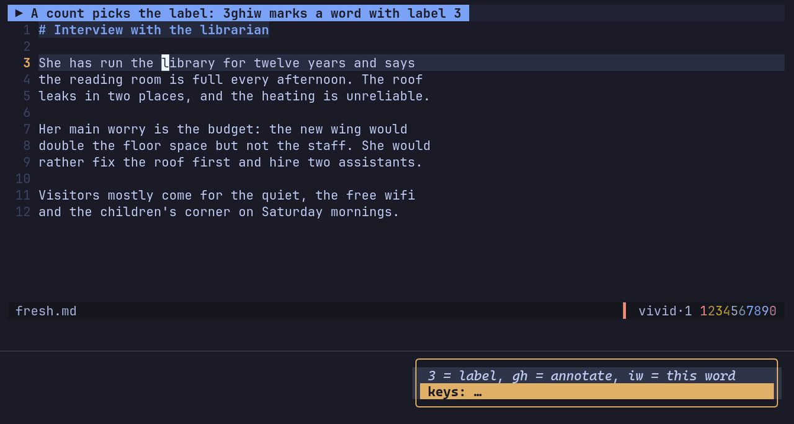
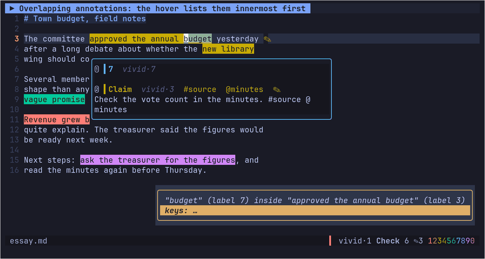

# earmark.nvim

Highlight and label spans of text in Neovim, and keep those annotations attached to the
text, even while the text keeps changing.




Every feature, with clips and the keys to try: [docs/demos/index.html](docs/demos/index.html).

- **Labels come from sets.** The default sets are five generated palettes with keys 1–99,
  and you can define your own.
- **A count picks the label:** `3ghiw` marks a word with label 3.
- **No count opens a small prompt** next to the text: type a key, a name or part of one,
  see the colour live on the text, press Enter. Tab names the label as you go.
- **Annotations survive what usually breaks highlights:** live edits, formatters
  rewriting the buffer, `:e!`, edits made outside Neovim, renamed files, and undo.
  - Changing its first or last words (`cw`, `ciw`, `s`, `C` …) keeps the new words in it.
  - When the annotated text is rewritten, the annotation is marked **stale**.
  - When the text is deleted, it is **detached**, never dropped. It comes back if the text
    returns (undo, paste).
- **Plain JSON storage** inside your project (`<root>/.earmark/`), so annotations travel
  with the repo or notebook.

Requires Neovim 0.11+. Full reference: `:help earmark`. Something off? `:checkhealth earmark`.

## Install (lazy.nvim)

```lua
{ 'Crackerfracks/earmark.nvim', opts = {} }
```

From a local checkout (how Stephen's config should load it while it's private):

```lua
{
  dir = '~/Projects/earmark.nvim',
  name = 'earmark.nvim',
  lazy = false, -- it must see the buffers Neovim starts with, and own `gh` from the start
  opts = {
    -- default_label = 'vivid/3',
    -- prompt = { ask_name = 'always' },
  },
}
```

## Quickstart (60 seconds)

1. Put the cursor on a word and type `3ghiw`. The word gets label 3 of the current set.
2. Type `ghip` without a count: a prompt opens beside the paragraph. Type `12`, watch the
   colour change on the text, press `<CR>`.
3. Press `<leader>mm` on an annotation and write a note with a `#tag` in it. `q` saves.
4. Rest the cursor on it: the hover shows the label, its name, the tag and the note.
5. `<leader>mp` lists every annotation in the file; `<leader>md` lists the ones whose text
   changed or disappeared.

`make demo` writes a small annotated project to `/tmp/earmark-demo` and prints the command
that opens it with this checkout, if you want to look before touching your config.

## Use

`<leader>m?` opens a list of every key below, grouped the same way and showing your own
mappings; `<CR>` on a row runs it. With [which-key](https://github.com/folke/which-key.nvim)
installed, each key also gets a short description and an icon for its group.

**Annotate**

| Keys | Action |
|---|---|
| `{count}gh{motion}` | annotate with label `{count}` of the current set (`3ghiw`, `12gh$`) |
| `gh{motion}` | annotate, choosing the label in a prompt (see below) |
| `{count}ghh` | annotate the line |
| `{Visual}{count}gh` | annotate the selection (block selections: one annotation per line) |
| `.` | repeat with the same label, no prompt |
| `<leader>mo` | give every other occurrence of the annotated text the same labels |

**Change the annotation under the cursor**

| Keys | Action |
|---|---|
| `<leader>ml` | change its label (`{count}` picks among overlapping ones) |
| `<leader>ma` | add another label |
| `<leader>mr` | name (or rename) its label for this file; an empty name clears it |
| `<leader>mg{motion}` / `{Visual}<leader>mg` | move it onto the motion / selection (note and labels stay) |
| `<leader>mx` | erase it (Visual: every annotation in the selection) |
| `<leader>mX` | erase every annotation in the buffer (restorable) |
| `<leader>mu` | restore the most recently erased |

**Notes and tags**

| Keys | Action |
|---|---|
| `<leader>mm` | open / close its note (`{count}` picks among overlaps) |
| `<leader>mt` | add / remove tags (lists every tag you've used) |
| `<leader>mi` | show the details float now and move into it (scroll; `q` closes) |
| `<leader>mh` | details when the cursor stops: on / off |
| `<leader>mv` | `#tags` at the ends of lines: on / off (off at startup) |

**Move**

| Keys | Action |
|---|---|
| `<leader>mn` / `<leader>mN` | next / previous annotation (wraps; `{count}` skips) |
| `<leader>m]` / `<leader>m[` | next / previous with the label under the cursor |
| `<leader>mj` | jump labels on every visible annotation ([flash.nvim](https://github.com/folke/flash.nvim); without it, the picker) |

**Find and review**

| Keys | Action |
|---|---|
| `<leader>mp` / `<leader>mP` | pick an annotation in this file / in the whole project |
| `<leader>mq` | this file's annotations into the quickfix list |
| `<leader>md` | review the annotations whose text changed or disappeared |
| `{Visual}<leader>mR` | attach the annotation chosen in the review list to the selection |
| `<leader>mD` | compare an annotation's original text with what it says now |

**Label sets**

| Keys | Action |
|---|---|
| `<leader>ms` | switch to the next label set (a popup shows its colours) |
| `<leader>mS` | choose the label set from a list |
| `<leader>mc` | the palette: every label of the set as a colour patch with your name for it, its colour's name, hex and uses; `<CR>` makes it the label `gh` offers first, digits jump to a key, `r` names it, `<Tab>` switches sets |

**Export and zk**

| Keys | Action |
|---|---|
| `<leader>me` | export this file's annotations to Markdown (asks where; opens it in a split) |
| `<leader>mz` | make a [zk](https://github.com/zk-org/zk) note from the annotation, or open the note it has; in a note, list the annotations linked to it (see [zk](#zk)) |
| `<leader>m?` | the key list |

### The label prompt

`gh` without a count opens a one-line prompt beside the span. The span shows the selected
colour while you type, and the list under the input narrows as you go:

- digits match keys first, then the shades of that family (`3` → 3, 13, 23 …);
- anything else matches keys, then label names (fuzzy);
- empty input offers the last label, then the labels already used in this file.

Each row shows the label's colour, its key, your name for it and the colour's name
("Tangerine"). With a count (`3gh`) there's no prompt; a small hint under the cursor shows
which label the count picked while you type the motion (`prompt.count_hint`).

### Colour names

Every colour gets a human name: the nearest of about 700 names from the
[xkcd colour survey](https://xkcd.com/color/rgb/) (public domain), measured in OKLab, a
perceptual colour space. Labels of one set get distinct names, so two shades of one
family never both read "Coral". The names show in the prompt, the palette, the hover and,
for a label you haven't named, the statusline. `color_names = false` hides them; a
function `color_names = function(hex) return name end` supplies your own (return nil to
fall back), and a set's label can carry `color_name = '…'`.

### Light and dark colour schemes

The label colours are designed on a dark background. On any other background earmark
shifts each colour's lightness (keeping its hue) so it stands out from the page as much as
it does on dark: on a light theme a highlight sits a little darker than the page instead
of brighter, so it keeps the same weight. It follows `:colorscheme` and `'background'`
changes as they happen. The label itself doesn't change (its number, name, colour name and
hex stay the same); only how it's drawn does. `color_adapt = false` draws the exact colours.

| In the prompt | |
|---|---|
| `<CR>` | apply the selected label |
| `<Tab>` | like `<CR>`, then name the label (the name stage); `<Tab>`/`<CR>` there accepts the name |
| `<S-Tab>` | back to the label stage |
| `<C-n>` `<C-p>` / `<Down>` `<Up>` (Normal: `j` `k`) | move through candidates |
| `<C-s>` | try the next label set |
| `<Esc>` | Normal mode (edit the query with the usual motions); `<Esc>`/`q` again cancels. In the name stage after choosing a label, `<Esc>` applies the label without naming it |

Names are per file, and the project remembers them: once you name label 3 "vague" in one
file, the first label 3 you use in any other file of that project is called "vague" there
too (`<root>/.earmark/names.json`, the directory default). Rename or clear it in that file
with `<leader>mr`. The name stage is pre-filled from what you called the label before: in
this file, then elsewhere in the project, then anywhere (`<storage_dir>/names.json`). An
empty name clears it for this file. With `prompt.ask_name = 'first_use'` (default) you are
asked to name a numbered label the first time you use it in a project; `'always'` and
`'never'` do what they say.

Annotating exactly the same span again with another label asks first: <kbd>a</kbd> (or
<kbd>Enter</kbd>) adds the label to it, so both show as an overlap; <kbd>r</kbd> replaces its
label (as `<leader>ml` does); <kbd>Esc</kbd> cancels. `.` repeats your answer without asking.
`prompt.confirm_stack = false` always adds, without asking. With a label it already has,
nothing changes.

### Notes and the hover

`<leader>mm` opens the annotation's note, a Markdown buffer in a float right under the
span (an empty note starts in Insert mode). `q`, `:w`, `<C-s>`, leaving the float or
closing it any other way saves it; `,s` moves it to a split at the bottom and `,f` back
(`,` being your `maplocalleader`). Clearing all the text removes the note. Write `#tags`
and `@identifiers` anywhere in a note; earmark picks them up.

When the cursor rests on an annotation that has a name, a note, tags, extra labels or a
stale/ambiguous status, a small float shows all of that without taking focus. It stays
while you move inside the annotation and goes away when you leave it, type, scroll or start
an operator. Overlapping annotations are listed innermost first (①, ②, …). Set
`hover.show_when = 'always'` to see it on every annotation.

### Finding annotations

`<leader>mp` and `<leader>mP` open your picker ([snacks.nvim](https://github.com/folke/snacks.nvim),
then [telescope.nvim](https://github.com/nvim-telescope/telescope.nvim), else `vim.ui.select`;
set `picker` to force one). Each entry shows the label name, the text, tags and the first
line of the note, so typing `#todo` or part of a note narrows it. The commands take a query
up front:

```vim
:Earmark pick #todo status:stale
:Earmark pick_all label:3 has:note budget
:Earmark qf all #source          " into the quickfix list instead
```

Query words: `#tag`, `@ident`, `label:<key or name>`, `set:<name>`, `status:ok|stale|ambiguous|detached`,
`has:note`, `has:tags`, `has:zk`; anything else matches the text, name or note.

`<leader>md` lists annotations that are **stale** (their text was rewritten),
**ambiguous** (the text appears more than once) or **detached** (the text is gone). For each
one you can jump to it, compare the original with the current text, accept the current text,
move it to one of the places its text could be now (exact or close matches, scored), attach
it to a selection (`{Visual}<leader>mR`), or erase it.

`:Earmark scratch` reopens a scratch buffer you annotated earlier, with its text and
annotations.

### Export

`<leader>me` writes a Markdown file with every annotation, grouped by label (with your
names for them), each with its text, line numbers, tags and note, plus a **Detached** section
for annotations whose text is gone. Inside a project it suggests
`<root>/.earmark/export/<project>-<path-of-file>.md` (`export/` is gitignored).
`export.location = 'beside'` writes it next to the annotated file instead, as
`<name>.earmark.md`; `{ 'project', 'beside' }` writes both (you're asked about the first),
and a function `(buf, ctx) -> path` picks any place. Set
`export.group_by` to `'position'`, `'tag'` or `'time'`, or `export.format` to a function
`(list, ctx) -> lines` to write your own body. An annotation with a zk note gets a
`→ [title](path)` line, with the path relative to the export file.
`:Earmark color #rrggbb` (or `reset`)
recolours the label under the cursor in this file only.

### Indicators

At the end of the line an annotation ends on, earmark shows a `✎` for each note (`✎✎✎ +2`
past three), in the label's colour. `<leader>mv` adds its `#tags` and its `@identifiers` as
`[A]` (hidden when Neovim starts; `indicators.tags = true` shows them from the start). When
the line is too long for them, they go on a virtual line below it instead. Nothing goes in
the sign column, and toggling changes only the view: nothing is re-read or saved.
`indicators.show_empty = true` adds a dot for annotations without a note;
`indicators.mode = 'none'` shows nothing at all.

### What overlaps look like

- Where annotations of **different labels** overlap, the overlap is drawn in the mix of their
  colours and underlined in the outer annotation's colour, so you see where each one starts
  and ends.
- Where annotations of **the same label** are nested (`this is` with `is` marked again), each
  inner level is a deeper shade of the same colour, the way highlighter strokes darken where
  they cross.
- An annotation's **second label** is an undercurl in that label's colour. With more labels
  the undercurl is cut into equal runs, one per extra label, so nothing is added to the line
  (`overlap.extra = 'squares'` instead puts a small square `■` per label after the span).
- **Stale** annotations (text rewritten) are drawn faded (most of the colour drained) and
  underdashed; **ambiguous** ones are underdotted.

Set `overlap = { style = 'top' }` to turn the mixing off: the smallest span is drawn on
top.

`:Earmark {info|peek|note|tags|toggle_hover|toggle_indicators|erase|clear|restore|next|prev|next_same|prev_same|jump|pick|pick_all|review|diff|reanchor|qf|scratch|check|export|occurrences|zk [new|link|pick|sources]|palette [set]|color|cycle_set|pick_set|relabel|add_value|rename|set [name]|reload|log|help}`

`:Earmark info` (the default) prints the details of the annotations under the cursor.

`:Earmark log` shows recent warnings and errors (also written to `<storage_dir>/earmark.log`).

## Configure

Defaults:

```lua
require('earmark').setup({
  -- Strings are generated numbered palettes; named tables are your own sets.
  sets = { 'vivid', 'pastel', 'earth', 'metal', 'cyber', 'feedback' },
  sets_dir = nil, -- your set files; default ~/.config/earmark/sets, false to skip
  default_label = nil, -- offered first before you've used any label, e.g. 'vivid/3'
  current = nil, -- set a count resolves against (default: first)
  root_markers = { '.earmark', '.zk', '.git' },
  storage_dir = vim.fn.stdpath('data') .. '/earmark', -- files outside any root, scratch buffers
  stale_threshold = 0.6, -- similarity to the original text below which an annotation is stale
  context = 32, -- bytes of surrounding text remembered on each side
  keys = { -- false disables all defaults; any entry can be false too
    operator = 'gh', line = 'ghh',
    erase = '<leader>mx', clear = '<leader>mX', restore = '<leader>mu',
    next = '<leader>mn', prev = '<leader>mN',
    cycle_set = '<leader>ms', pick_set = '<leader>mS', peek = '<leader>mi',
    note = '<leader>mm', toggle_hover = '<leader>mh',
    tags = '<leader>mt', toggle_indicators = '<leader>mv',
    next_same = '<leader>m]', prev_same = '<leader>m[', jump = '<leader>mj',
    pick = '<leader>mp', pick_all = '<leader>mP', review = '<leader>md', diff = '<leader>mD',
    reanchor = '<leader>mR', qf = '<leader>mq',
    export = '<leader>me', occurrences = '<leader>mo', regrow = '<leader>mg', zk = '<leader>mz',
    relabel = '<leader>ml', add_value = '<leader>ma', rename = '<leader>mr',
    palette = '<leader>mc',
  },
  prompt = {
    width = 44, -- inner width of the prompt float
    max_rows = 8, -- candidate rows shown
    ask_name = 'first_use', -- 'first_use' | 'always' | 'never'
    count_hint = true, -- after 3gh, show which label the count picked
    confirm_stack = true, -- ask before labelling a span that's already labelled
  },
  ui = { border = 'rounded' },
  picker = 'auto', -- 'auto' | 'snacks' | 'telescope' | 'select'
  statusline = { digits = true, color_name = true },
  color_names = true, -- false, or function(hex) -> name|nil
  color_adapt = true, -- shift colours to suit a light (or any other) colour scheme
  export = { group_by = 'label', include_detached = true, format = nil, location = 'project' }, -- or 'beside', a function, or a list
  zk = {
    cmd = 'zk',
    notebook = nil, -- default: the nearest .zk above the file, then $ZK_NOTEBOOK_DIR
    dir = nil, -- notebook subfolder for new notes, or function(ctx) -> subfolder
    template = nil, -- your own zk template (gets the body and --extra fields)
    open = true, -- open a new note in a split
  },
  note = {
    layout = 'float', -- 'float' | 'split'
    width = 0.6, max_width = 100, -- fraction of the window, and a column cap
    height = { min = 5, max = 0.5 },
    winblend = 0,
  },
  hover = {
    auto = true, -- show when the cursor rests on an annotation (<leader>mh toggles)
    delay = 120, -- ms
    show_when = 'named_or_note', -- or 'always'
    max_width = 0.5, max_height = 0.5,
  },
  indicators = {
    mode = 'eol', -- 'eol' | 'none'
    tags = false, -- #tags and [identifiers] too (<leader>mv toggles)
    max_pencils = 3, -- then "+N"
    identifiers = true, -- show @ident tags as [ident]
    show_empty = false,
  },
  overlap = { style = 'blend', extra = 'split' }, -- 'blend' | 'top'; 'split' | 'squares'
})
```

Your own sets:

```lua
sets = {
  'vivid',
  'feedback', -- the set that ships with earmark (see below)
  critique = { labels = {
    { key = 'c', name = 'contradiction', color = '#e06c75' },
    { key = 'v', name = 'vague' },          -- colour picked automatically
    'cut this',                              -- key defaults to its position: 3
  } },
  mine = { generate = 'numbered', palette = { L = 0.7, C = 0.15, h0 = 200, zig = 0.04 } },
},
```

A count resolves to the label whose key is that number, else to the label at that position.

### Label set files

Sets can also live in files, one set per file, named after the file:

- your own: `~/.config/earmark/sets/*.lua` or `*.json` (`sets_dir` changes or disables this);
- a project's: `<root>/.earmark/sets/*.lua` or `*.json`, loaded when you open a file in that
  project. A project's set replaces a set of the same name.

Files are re-read when you save them in Neovim or come back to Neovim after editing them
elsewhere. Project Lua files run only after you trust them (`:trust`, Neovim's
`vim.secure`); JSON files never run code. `:Earmark log` lists files that failed to load,
and problems in the ones that did (a colour that isn't `#rrggbb` or `#rgb` gets a palette
colour instead); a broken set never stops the others loading. A label repeated with the
same key replaces the earlier one.

Labels can ask for more than a colour, which suits rubrics and surveys:

```lua
-- <root>/.earmark/sets/review.lua
return {
  labels = {
    { key = 'q1', name = 'Accuracy', color = '#e06c75',
      -- asked after the label; a choice may have its own colour
      choices = { { key = 'a', name = 'Correct' }, { key = 'b', name = 'Minor issue', color = '#e5c07b' }, 'Major issue' },
      -- a line of text, only for these choices
      text = { when = { 'b', 'c' }, prompt = 'What is wrong?' } },
    -- only offered once the annotation has q1 = b or c (others show why they're unavailable)
    { key = 'q1.1', name = 'Severity reason', requires = { q1 = { 'b', 'c' } } },
    { key = 'q2', name = 'Tone' },
  },
}
```

A value then reads `Accuracy · b Minor issue`, and the hover shows its text. `choices` can
also be a map: `{ a = 'Correct', b = 'Minor issue' }`.

A label can carry `tags = { 'option-a' }`: annotating with it adds those tags. A set can
carry `tags = { 'todo', 'nit' }`: `<leader>mt` lists them first.

### Feedback, and sets for one file

The `feedback` set is for reviewing something someone else wrote (a plan, a draft, a demo,
code). Its keys are 1 to 9, so a count picks the label: `2ghip` marks a paragraph "Change".

| Key | Label | Meaning |
|---|---|---|
| 1 | Keep | good as it is |
| 2 | Change | change this; the note says how |
| 3 | Wrong | incorrect, or a bug |
| 4 | Question | a question about this |
| 5 | Unclear | confusing or hard to follow |
| 6 | Cut | remove this |
| 7 | Idea | an idea or something to add |
| 8 | Prefer | choose this option |
| 9 | Later | not now |

Export the file (`<leader>me`) to hand the feedback over as a Markdown list, grouped by
label, with the notes.

A set can also belong to one file or a few. Put `<name>.earmark-set.json` in the same
folder as the file, or in a folder above it inside the project:

```json
{
  "extends": "feedback",
  "labels": [
    { "key": "a", "name": "Option A: one big picker", "tags": ["option-a"] },
    { "key": "b", "name": "Option B: two small pickers", "tags": ["option-b"] }
  ],
  "tags": ["pick"],
  "expires": "2026-12-01"
}
```

- `plan.earmark-set.json` applies to `plan.md`, `plan.html` and so on (any `plan.*`). Give
  `"files": ["drafts/*.md"]` to choose other files; the globs are relative to the set file's
  folder (`**/*.md`, `../drafts/*.md` and absolute paths work too; `[]` is no file).
- Opening one of those files switches to its set; leaving it switches back to the set you
  used before. `"auto": false` only lists it first instead.
- The set is listed (`<leader>mS`, `<leader>ms`, Ctrl-s in the prompt) only in its files, so
  sets made for one review don't fill up the list everywhere else.
- `"extends": "feedback"` starts from the feedback labels; a label with the same key
  replaces one of them.
- After the `"expires"` day (`YYYY-MM-DD`) the set is no longer offered. Annotations made
  with it keep their colours.
- A set for some files never replaces a general set of the same name.

### Statusline

`require('earmark').statusline()` returns a statusline string (empty in buffers earmark
doesn't track): a swatch and the label the next `gh` uses, the number of annotations and
notes, `⚠` with detached/ambiguous ones, and for numbered sets the digits `1234567890` in
their colours.

Pass the highlight group of the section it sits in as `hl`: its colours then sit on that
section's background, and the section's colours come back after them (without it, they
reset to `StatusLine`).

```lua
-- mini.statusline, inside your content.active function
local earmark = require('earmark').statusline({ hl = 'MiniStatuslineFileinfo' })
return MiniStatusline.combine_groups({
  { hl = mode_hl, strings = { mode } },
  { hl = 'MiniStatuslineFilename', strings = { filename } },
  '%=',
  { hl = 'MiniStatuslineFileinfo', strings = { earmark, fileinfo } },
})

-- lualine: the group of the section it's in (`:Inspect` over the section shows it)
sections = { lualine_x = { function() return require('earmark').statusline({ hl = 'lualine_x_normal' }) end } }
```

`<Plug>` mappings: `(earmark-operator)`, `(earmark-line)`, `(earmark-erase)`,
`(earmark-clear)`, `(earmark-restore)`, `(earmark-next)`, `(earmark-prev)`,
`(earmark-cycle-set)`, `(earmark-pick-set)`, `(earmark-peek)`, `(earmark-note)`, `(earmark-toggle-hover)`,
`(earmark-tags)`, `(earmark-toggle-indicators)`, `(earmark-next-same)`, `(earmark-prev-same)`,
`(earmark-jump)`, `(earmark-pick)`, `(earmark-pick-all)`, `(earmark-review)`, `(earmark-reanchor)`, `(earmark-qf)`, `(earmark-diff)`,
`(earmark-export)`, `(earmark-occurrences)`, `(earmark-regrow)`, `(earmark-zk)`, `(earmark-relabel)`, `(earmark-add-value)`,
`(earmark-rename)`, `(earmark-palette)`, `(earmark-help)`.

## Storage

- **File inside a project:** `<root>/.earmark/docs/<relative path>.json`, where `<root>` is
  the nearest directory containing one of `root_markers`.
- **Other files:** `<storage_dir>/files/<absolute path>.json`.
- **Scratch, unnamed and plugin buffers:** `<storage_dir>/scratch/<id>.json`.

Each record (schema v2) holds the annotations, their notes and tags, the names you gave
labels in that document, and a fingerprint of the text they were recorded against. That
text itself is kept beside it as a snapshot (`<base>/snap/…`). On load, the snapshot is
diffed against the current text to re-anchor each annotation. Inside a project, `snap/` is
listed in an auto-written `.earmark/.gitignore`, so committed records stay small; a fresh
clone without snapshots re-anchors by quote and surrounding text instead.

Tags you use are counted in `<storage_dir>/tags.json`, which feeds the `<leader>mt` list.

How an annotation finds its text again, in order: the diff of the saved snapshot against
the current text; the exact text with the most similar surroundings (each annotation
remembers enough surrounding text to be unique when it is made); and, when the text itself
was edited and moved, the closest fuzzy match (whitespace ignored). When two places fit
equally well, the annotation is marked **ambiguous** instead of guessing, and `<leader>md`
offers the candidates. `:Earmark check` prints how each annotation was placed; run
headless, it exits with status 1 if any is detached:

```sh
nvim --headless notes/draft.md -c 'Earmark check' -c q
```

Writes are atomic. A record that can't be parsed is left untouched, and saving for that
buffer is disabled with a warning. v1 records (snapshot inline) are read as is and rewritten
as v2 on the next save.

## API

Positions are 0-based `{ row, col }` (byte columns), spans end-exclusive; `buf` 0 is the
current buffer. A value is `{ set = 'vivid', label = '3', choice = 'b'?, text = '…'? }`.
Annotations and tables you get back are copies: changing them changes nothing.

```lua
local em = require('earmark')
local a = em.annotate(buf, { 0, 4 }, { 0, 9 }, { set = 'vivid', label = '3' })  -- nil if the span is empty
em.list(buf)                -- { { annotation = a, s = {r,c}, e = {r,c} }, ... } sorted; s/e nil when detached
em.at(buf, pos)             -- same shape, at pos (default cursor), innermost first
em.get(buf, a.id)           -- nil if it isn't there
em.set_note(buf, a.id, 'text #tag')   -- nil or '' clears
em.set_tags(buf, a.id, { 'todo' })
em.set_values(buf, a.id, { { set = 'vivid', label = '3' }, { set = 'review', label = 'q1', choice = 'b' } })
em.erase(buf, { a.id })     -- to the trash
em.restore(buf)             -- the last erased batch
em.rename_label(buf, { set = 'vivid', label = '3' }, 'Vague')
em.names(buf)               -- { ['vivid/3'] = 'Vague' }
em.display_name(buf, value) -- 'Vague': this file's name for the label, else its own name (or key)
em.label(value)             -- { set, key, name, color, desc, tags }, or nil if there's no such label
em.export(buf, { group_by = 'tag' })  -- Markdown lines
em.pick({ scope = 'project', query = '#todo' })
em.hover.show() ; em.hover.hide()
em.statusline({ hl = 'MiniStatuslineFileinfo' })  -- hl: the section it sits in
em.on('Note', function(data) print(data.buf, data.action, vim.inspect(data.ids)) end)
em.zk.promote(buf, a.id, { open = false }, function(err, path) end)  -- see zk below
em.zk.notebook(buf)         -- the notebook's path, or nil and the reason
em.zk.path(a, buf)          -- absolute path of the annotation's note, or nil
```

Events: `User EarmarkChanged` for every change, plus a specific `User Earmark<Action>`
(`EarmarkAdd`, `EarmarkUpdate`, `EarmarkErase`, `EarmarkRestore`, `EarmarkRepair`,
`EarmarkNote`, `EarmarkLoad`, `EarmarkZk`), all with `data = { buf, action, ids }`. `em.on(name, fn)` is
shorthand for those autocmds. `ids` is nil for `EarmarkLoad`, `EarmarkRepair` (an edit
detached, re-attached or changed the status of annotations) and a label's name or colour
changing. Setting what is already there fires nothing. Anything not listed here is
internal and may change.

### zk

earmark can turn an annotation into a note in a [zk](https://github.com/zk-org/zk) notebook.
It runs the `zk` program itself, so all you need is zk (Arch: `sudo pacman -S zk`) and a
notebook (`zk init`). zk-nvim is not required.

- **`<leader>mz`** on an annotation makes a note with the annotated text as a quote, the
  annotation's note, and a `[source](…#L12)` link back to the line. The note is titled
  after the first line of the annotation's note, else the start of the quoted text, and
  opens in a split (`zk.open = false` to stay). The annotation keeps its own note and
  remembers the zk note; the hover shows `↗ zk <file name>`.
- **Press it again** and the note opens (or the cursor goes to the window already showing
  it), so you never get a second note by accident. If the note's file is gone, earmark
  asks whether to make a new one or unlink it. `:Earmark zk new` makes a new note anyway.
- **Same text, same label:** after promoting, earmark offers to link the other annotations
  in the file with the same text and label (made by `<leader>mo`, say) to the same note.
- **`:Earmark zk link`** attaches a note that already exists, picked from `zk list`.
- **`:Earmark zk pick`** lists the project's annotations that have a note; `<CR>` opens the
  note. The query word `has:zk` does the same in any picker or `:Earmark qf`.
- **In a note**, `<leader>mz` with nothing under the cursor (or `:Earmark zk sources`) lists
  the annotations linked to it. zk's own backlinks find the source files too, through the
  `[source]` link.

The note starts with frontmatter that earmark writes, so zk indexes its title and tags:

```yaml
---
title: "Why does the fox run?"
tags: ["npc", "todo"]        # the label's name, then the annotation's tags
earmark:
  id: "…"
  set: "vivid"
  key: "3"
  label: "NPC"
  source: "notes/chapter-1.md"   # inside the notebook; absolute when outside it
  line: 12                        # left out when the annotation is detached
---
```

The `[source]` link is relative to the note's folder, so it works wherever the note goes
in the notebook. A file outside the notebook gets an absolute link. The annotation stores
the note's path relative to the notebook, so the project can move or be cloned elsewhere.

Which notebook: `zk.notebook` if you set it, else the nearest folder with a `.zk` above the
file, else `$ZK_NOTEBOOK_DIR`. Options:

- `zk.dir`: the notebook subfolder for new notes. It can be a function that gets
  `{ buf, annotation, value, label, notebook, source }` and returns a folder, e.g. one
  folder per label: `dir = function(ctx) return 'people/' .. ctx.label:lower() end`. A
  folder outside the notebook is refused.
- With a zk `filename = "{{slug title}}"`, two notes with the same title would share a file:
  zk hands back the existing note, and earmark says so instead of linking to it.
- `zk.template`: one of your own zk templates instead of earmark's. It gets the body only
  (quote, note, source link) and `--extra id=…,set=…,key=…,line=…`; earmark writes no
  frontmatter then, so your template decides it.
- `zk.cmd`: the zk program, if it isn't `zk` on your `PATH`.

**The notebook as the project.** `.zk` is one of `root_markers`, so a notebook is also an
earmark project: annotations on notes go in `<notebook>/.earmark/`, which zk ignores. A
`.earmark` folder nearer to the file wins over the notebook (`.earmark` comes first in
`root_markers`), so don't create one inside the notebook unless you mean to start a
separate project there.

`:checkhealth earmark` shows whether zk is installed, its version, and the notebook for
the current file.

## FAQ

**Doesn't `gh` start Select mode?** In stock Neovim, yes. earmark takes it over because Select
mode is rarely used and `gh` reads as "highlight". Set `keys.operator` (and `keys.line`) to
something else if you use Select mode.

**Why does `ghh` sometimes wait before marking the line?** `gh` is an operator, so after
`ghh` Neovim can't yet tell whether `h` was the motion or the start of a longer mapping and
waits `'timeoutlen'`. Type it quickly, or map `line` to another key.

**Will a formatter or `git checkout` lose my annotations?** No. Each record keeps a snapshot of
the text it was made against and re-finds every annotation from it (then by quote and
context, then fuzzily). Anything it can't place with confidence is marked stale, ambiguous or
detached and shows up in `<leader>md`; nothing is dropped. `:Earmark check` shows where each
one landed.

**Should I commit `.earmark/`?** That's the idea: records and label names are small JSON and
diff well. The text snapshots (`.earmark/snap/`) and exports are gitignored automatically.

**Neovim 0.12?** Supported. earmark uses `vim.text.diff` where it exists and avoids APIs
deprecated in 0.12.

**Numbers for labels are hard to remember.** Name them: `<Tab>` in the prompt, or
`<leader>mr`. Names are per file and remembered for the project, and the prompt matches
names as you type.

## Develop

`make test` runs the mini.test suite headless. It uses your lazy.nvim copy of mini.nvim if
present, otherwise clones it into `deps/`. `make deps` also fetches flash.nvim so the jump
test runs instead of being skipped. `make demo` builds the demo project described above. The
docs test checks that every default key and subcommand is in this README and in
`doc/earmark.txt`, and that the help file's tags are valid.

## Status (2026-10-18)

The 2026-10 rebuild plan is done: milestones M0 to M10 landed as PRs #1 to #11, and #12
fixed what an audit against the old Numhi conversations found. Since then: bug fixes found
while recording the demos (#13), the demos page (#14, #16 to #18), colour names, the palette
and the count hint (#15), the same-span question (#19), colours that adapt to light themes
(#20), new overlap looks (#21), a clearer naming prompt and exports beside the file (#22).
The plan is in `docs/PLAN.md`.

Decided with Stephen on 2026-10-18 (from his comments on the demos page):

1. Naming: the prompt asks for a name the first time a label is used in a project
   (`prompt.ask_name = 'first_use'`), and that name then applies in the project's other
   files (`.earmark/names.json` is committed). The naming step now says plainly what is
   being named.
2. Identifier tags are written `@A` in notes and shown as `[A]` at the end of the line;
   `<leader>mv` shows or hides tags and identifiers (hidden at startup); pencils always show.
3. Overlaps: mixed colours with the outer colour as underline; a second label is an
   undercurl and more labels split the undercurl into equal runs (nothing shifts the line);
   nested levels of one label are deeper shades; stale marks are faded.
4. The hover header is the label colour as text (`▍ name`), not a filled bar.
5. Colours adapt to the colour scheme's background (`color_adapt`).
6. `gh` without a count always opens the prompt; `<CR>` on empty input reuses the last label.
7. Text snapshots are gitignored, so a fresh clone re-anchors by quote and context only.
8. Exports go to `<root>/.earmark/export/<project>-<path>.md` by default; `export.location`
   can put them next to the annotated files too.
9. Another label on exactly the same span asks first: a adds it (an overlap), r replaces,
   Esc cancels (`prompt.confirm_stack`); `<leader>ml` replaces directly.
10. Notes open in a float by default; `picker = 'auto'`; `<leader>ml` with a count picks
    among overlapping annotations; `<leader>mg` accepts the new text as the annotation's text.

Still open:

- What the statusline shows: the next label, counts, the warning count and the digit row.
- Storage is JSON only; SQLite and encryption are dropped.
- An annotation re-placed by a close fuzzy match (one typo) stays "ok" rather than "stale".
- `<leader>mo` has no one-step undo (erase the extra annotations with `<leader>mx`).
- Set files are reloaded when Neovim regains focus or you switch buffers (no file watcher).
- The hover clip on the demos page needs re-recording (it rests on the wrong word).
